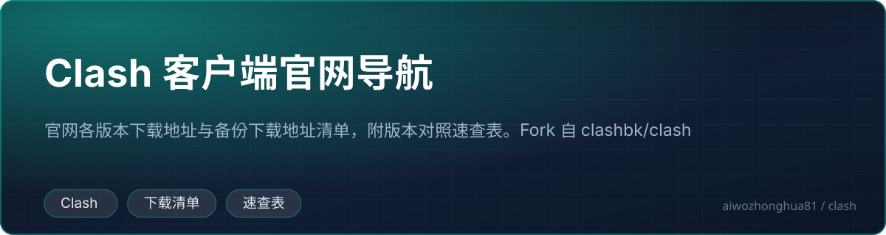

<!-- 中文说明开始 -->

# 🇨🇳 中文详细说明 · Clash 客户端官网导航

<!-- 徽章区开始 -->
<p align="center">
  <a href="https://github.com/aiwozhonghua81/clash"></a>
  
  
  
  
  
</p>
<p align="center">
  
  
  
</p>
<p align="center">
  
</p>
<!-- 徽章区结束 -->

> **本节是给中文读者写的「怎么看这份清单」的说明 + 一份更易读的速查表。**
> 下方「↓ 上游 README 原文开始 ↓」以下是上游 [clashbk/clash](https://github.com/clashbk/clash) 的原文，**一字未删**。

---

## 🧐 一、这是什么（一句话说清）

**这是一个「Clash 系代理客户端的导航页」—— 一张表格，把市面上能找到的 Clash 客户端按「还在维护吗 / 支持哪些系统 / 去哪下载 / 有没有教程」列清楚，让你不用满世界找下载链接。**

### 先搞懂三个名词

| 名词 | 大白话解释 |
| --- | --- |
| **Clash** | 一个开源的代理规则引擎（读 YAML 配置、按规则决定每个请求走哪条线路）。它本身**不带界面**，只是个内核。 |
| **Clash 客户端** | 给 Clash 内核套上一层图形界面（GUI），方便你点点鼠标就能用。**下面表格里的每一行都是不同的客户端。** |
| **机场 / 中转** | 提供代理线路的商业服务。你有客户端，还得有机场的订阅链接，两样齐了才能用。 |

### ⚠️ 一句话说清楚边界

**本仓库不提供任何代理线路、不提供机场、不提供节点。** 它就是一个「客户端下载链接 + 使用教程」的索引页 —— 相当于一个**导航站**。

---

## 👥 二、适合谁用 / 能解决什么问题

### ✅ 适合你，如果你是

| 你是 | 你会得到什么 |
| --- | --- |
| **刚接触代理的新手** | 不知道该装哪个客户端 → 下面「怎么选」一节直接告诉你 |
| **老用户，客户端要淘汰了** | 表里带 🔴 的已停更，你需要换新的 |
| **iPhone / iPad 用户** | 表里 iOS 一栏能用的不多，直接看 iOS 推荐 |
| **路由器用户** | 想让全家设备都走代理 → 看进阶部分（OpenClash / PassWall2） |
| **想找官方下载页** | 表里「仓库」列全是官方地址，不用担心下到盗版 |

### 🎯 能解决的具体问题

1. **「该装哪个？」** —— 一张表横向对比，不用一个个试
2. **「这个客户端还活着吗？」** —— 🟢 维护中 / 🔴 已停更，一目了然
3. **「Mac 上装哪个？」** —— 看列，不用一个个搜
4. **「教程在哪？」** —— 每行都有 wiki 教程链接
5. **「iOS 上怎么办？」** —— iOS 不允许安装第三方 Clash 内核，表格里的 iOS 支持列其实是「**能不能在 iOS 上装**」的答案

---

## ⚙️ 三、核心功能 / 内容（其实就是这张表的 16 行）

| # | 客户端 | 维护 | Windows | macOS | Android | iOS | Linux | 一句话评价 |
| --- | --- | :-: | :-: | :-: | :-: | :-: | :-: | --- |
| 1 | **FlClash** | 🟢 | ✅ | ✅ | ✅ | ❌ | ✅ | **FlClash**，界面现代化，多平台覆盖最广，新手首选 |
| 2 | **Clash Verge Rev** | 🟢 | ✅ | ✅ | ❌ | ❌ | ✅ | Windows / macOS 首选，界面清爽 |
| 3 | **ClashMi** | 🟢 | ✅ | ✅ | ✅ | ✅ | ✅ | 覆盖最全（含 iOS），由 KaringX 团队维护 |
| 4 | **Hiddify Next** | 🟢 | ✅ | ✅ | ✅ | ✅ | ✅ | 一站式代理 App，自带多种协议 |
| 5 | **Clash Meta for Android** | 🟢 | ❌ | ❌ | ✅ | ❌ | ❌ | Android 专用 |
| 6 | **Karing** | 🟢 | ✅ | ✅ | ✅ | ✅ | ✅ | 多平台，安卓上口碑好 |
| 7 | **Clash Nyanpasu** | 🟢 | ✅ | ✅ | ❌ | ❌ | ❌ | Rust 写的，界面轻快 |
| 8 | **Clash-Party** | 🟢 | ✅ | ✅ | ❌ | ❌ | ❌ | 分支多，容易混淆 |
| 9 | **Surge for iOS** | 🟢 | ❌ | ❌ | ❌ | ✅ | ❌ | iOS 付费 App（App Store，4.99 美元） |
| 10 | **V2rayN** | 🟢 | ✅ | ✅ | ❌ | ❌ | ❌ | 老牌 Windows 客户端，支持协议多 |
| 11 | **Shadowrocket** | 🟢 | ❌ | ❌ | ❌ | ✅ | ❌ | iOS 付费 App（App Store，2.99 美元），俗称「小火箭」 |
| 12 | **Clash Verge** | 🔴 | ✅ | ✅ | ❌ | ❌ | ✅ | **已停更**，被 Clash Verge Rev 取代 |
| 13 | **Clash for Windows** | 🔴 | ✅ | ✅ | ❌ | ❌ | ❌ | **已停更**，仓库已被删除，只剩备份 |
| 14 | **ClashX** | 🔴 | ❌ | ✅ | ❌ | ❌ | ❌ | **已停更** |
| 15 | **ClashX Pro** | 🔴 | ❌ | ✅ | ❌ | ❌ | ❌ | **已停更** |
| 16 | **Clash for Android** | 🔴 | ❌ | ❌ | ✅ | ❌ | ❌ | **已停更** |

> 📌 **原文里还有第 17 个客户端 ClashN（🔴 已停更）**，在上游 README 的「Clash客户端官网导航」小节里列出了下载和教程地址。

### 关于 🟢 / 🔴 这个标记

- 🟢 **维护中** —— 还在更新，能跟上新协议、新系统
- 🔴 **已停更** —— 作者不维护了。**原文明确警告**：

> ⚠️ 停更的客户端无法兼容新协议导致节点不可用，建议更新到更安全、更美观、兼容性更好的新版本

---

## 🚀 四、怎么快速上手

### 4.1 三步走（通用流程）

```
第 1 步  挑一个客户端（看下面的「怎么选」）
   ↓
第 2 步  从表格「仓库」列点进官方 Releases 页面，下载对应系统的安装包
   ↓
第 3 步  安装 → 打开 → 填入机场给的订阅链接（通常是一个以 http 开头、很长的一串）
   ↓
第 4 步  点「启动 / 开启系统代理」→ 完成
```

### 4.2 按系统选客户端（直接抄）

**🪟 Windows 用户**
```text
首选：FlClash        → https://github.com/chen08209/FlClash/releases
备选：Clash Verge Rev → https://github.com/clash-verge-rev/clash-verge-rev/releases
```

**🍎 macOS 用户**
```text
首选：FlClash          → https://github.com/chen08209/FlClash/releases
备选：Clash Verge Rev  → https://github.com/clash-verge-rev/clash-verge-rev/releases
```

**📱 iPhone / iPad 用户**

iOS 不允许第三方客户端自带代理内核，**唯一合规的路是走 App Store 的官方 App**：
```text
付费：Shadowrocket（俗称「小火箭」）→ https://apps.apple.com/us/app/shadowrocket/id932747118
付费：Surge             → https://apps.apple.com/us/app/surge-5/id1442620678
```
这两个是**收费**的（Apple 收费），是 iOS 上最主流的选择。

**🤖 Android 用户**
```text
首选：FlClash                  → https://github.com/chen08209/FlClash/releases
备选：Clash Meta for Android    → https://github.com/MetaCubeX/ClashMetaForAndroid/releases
      Karing                   → https://github.com/KaringX/karing/releases
      Hiddify Next             → https://github.com/hiddify/hiddify-app/releases
```

**🐧 Linux 用户**
```text
FlClash（唯一在表格里 ✅ 的 Linux 客户端）
```

### 4.3 进阶：路由器部署（全家设备加速）

原文推荐的路由器方案：

```text
OpenClash  → https://github.com/clashbk/clash/wiki/openclash/    （OpenWrt 插件）
PassWall2  → https://github.com/clashbk/clash/wiki/passwall2/
```

装在路由器上之后，家里手机、电视、电脑、访客设备全都不用单独装客户端。

### 4.4 怎么确认装对了

1. 客户端显示「已连接 / Running」
2. 浏览器打开 `https://ip.sb` 之类查 IP 的网站，IP 变成不是你自己家的
3. 能正常访问原本打不开的网站

---

## 🩺 五、常见问题 / 注意事项

### 坑 1：装了个已停更的客户端，节点全不能用

**原因**：新的代理协议（如更新的传输层协议）需要客户端内核支持。停更的客户端内核停在旧版本，**不认识新协议，节点就会失效**。

**解法**：换 🟢 的客户端。

### 坑 2：iOS 上装不了表格里的大部分客户端

**原因**：iOS 系统限制，只有走 App Store 的官方 App 才能用（Shadowrocket / Surge）。

**解法**：看上面 4.2 的 iOS 部分。

### 坑 3：Clash-Party / Clash Nyanpasu / Mihomo Party 分不清

这三个名字很像，是不同分支。

- **Clash-Party** —— 🟢 还在维护（仓库 `mihomo-party-org/clash-party`）
- **Clash Nyanpasu** —— 🟢 还在维护（仓库 `libnyanpasu/clash-nyanpasu`）
- **Mihomo Party** —— 🔴 **已停更**，名字最像但已死，**别下错**

### 坑 4：Clash for Windows 的下载链接好像打不开

**原因**：它已经停更，**原仓库被作者删除了**，表格里那个是「备份」链接（指向 `clashbk` 这个备份组织的镜像）。

**解法**：直接用 FlClash 或 Clash Verge Rev。

### 坑 5：订阅链接打不开

原文在两个机场推荐下面都写了这句：

> 注：跳转链接可能会 **被墙**，如多次打开失败，请使用代理访问

**意思**：机场的注册链接本身打不开。**解法：先用别的代理访问它，拿到订阅链接后，再回到客户端里导入。** 这是个「先有鸡还是先有蛋」的问题。

### 坑 6：表格里带 ⚠️ 的行需要注意

原文表格里 `Clash Verge Rev` 那一行的 `Android` 列是 ❌，`Clash Meta for Android` 的 `Windows` 列是 ❌ —— **表格里的 ✅/❌ 是实打实的平台支持情况，不是「大概能用」**。下之前先看清对应列。

### 坑 7：教程和下载分散在两个地方

原文的「Clash客户端官网导航」小节把每个客户端的**下载地址**和**教程地址**分开列了。如果你在上面的大表里找不到某个客户端的教程，去那一节找。

### 坑 8：⚠️ 关于本仓库的性质

本仓库**只做导航**，不含任何程序代码，仓库里实际只有：
- `README.md` —— 你正在看的这份导航
- `.gitignore`

**任何声称「从这里下载 Clash 核心程序」的说法都是假的。** 真正的客户端请去表格里「仓库」列指向的官方地址下载。

---

## 🗂️ 六、目录结构速览

这个仓库**极其简单**，总共就两个文件：

```
clash/
├── README.md      ← 就是你看到的这份导航页（唯一有内容的文件）
└── .gitignore     ← Git 忽略规则
```

### 为什么这么简单？

因为这是 GitHub 官方的 **Wiki 承载仓库**：

- 所有客户端的**使用教程**放在仓库的 **Wiki** 里（`https://github.com/clashbk/clash/wiki/`）
- `README.md` 里的每个「教程」链接都指向 Wiki 的对应页面
- README 本身只做**索引**和**选择建议**

GitHub 上一个仓库可以只有 README + Wiki，没有代码也能正常提供教程服务。

### 页面结构速览（原 README 的骨架）

| 原 README 的小节 | 内容 |
| --- | --- |
| 顶部提示链接 | 机场推广链接 |
| 📊 Clash客户端汇总 | **16 行大表** —— 维护状态 + 5 个平台支持 + 仓库 + 教程 |
| 高速机场推荐 1 / 2 | 两个机场的套餐说明（流量、带宽、同时在线数） |
| 如何选择合适的客户端？ | 新手推荐（按系统）+ 进阶推荐（路由器） |
| Clash客户端官网导航 | 每个客户端的**下载地址 + 教程地址**逐条列出（含已停更的 ClashN） |

---

## 📊 七、本仓库说明

| 项目 | 说明 |
| --- | --- |
| **本仓库** | `aiwozhonghua81/clash` —— 一个 **fork（派生仓库）** |
| **上游项目** | **clash**（Clash 官网导航） |
| **上游地址** | https://github.com/clashbk/clash |
| **上游 Wiki（真正的教程都在这）** | https://github.com/clashbk/clash/wiki |
| **仓库性质** | 纯文档导航仓库，**不含任何程序代码** |
| **本仓库改动** | 仅在 README 顶部新增本中文说明区块；**未修改任何其他文件** |

### README 的结构

```
┌─────────────────────────────────────────────┐
│  👆 本节：中文详细说明 + 易读速查表            │  ← 本次新增
├─────────────────────────────────────────────┤
│  👇 下方：上游 README 原文（未删改）           │  ← 上游 clashbk/clash 撰写
└─────────────────────────────────────────────┘
```

- 上游 README 共 **154 行**，内容是：16 个客户端的汇总大表、2 个机场推荐、按系统的选择建议、以及逐条的下载地址和教程地址。**这些内容全部保留在下方。**
- 本中文区块的**增量价值**在于：
  1. 把原文那张 8 列大表**转成带「一句话评价」的 9 列表**，并按系统重新分组，新手 30 秒能选完
  2. 把「怎么用」的**实际步骤**（挑客户端 → 官方下载 → 导入订阅 → 开系统代理 → 验证）补齐了，原文只说「去看教程」
  3. 补充了 8 条**实际会踩的坑**，其中「iOS 装不了」「订阅链接被墙要套娃」「Clash-Party 和 Mihomo Party 别下错」是最常见的
- ⚠️ 原文里包含**机场推广链接**（ORYMI、星链加速）及其优惠码。这些是上游作者的内容，**本仓库只是 fork，未做任何删改**，也不对其做背书。是否使用请自行判断。

---

## 📌 快速自查清单

下载前对一遍：

- [ ] 选的是 🟢（维护中）的客户端
- [ ] 对应系统的列是 ✅（支持）
- [ ] 下载地址来自表格「仓库」列指向的**官方仓库**，不是第三方站
- [ ] 知道 iOS 只能用 Shadowrocket / Surge（且要付费）
- [ ] 明白本仓库只是导航，**不含任何程序和线路**

---

<!-- 中文说明结束 -->

---

↓ **上游 README 原文开始**（以下内容来自 [clashbk/clash](https://github.com/clashbk/clash)，未做任何删改） ↓

# Clash官网导航

欢迎来到 Clash官网导航！本页面为您汇总了各类 Clash 客户端，包含活跃更新项目和已停更项目，方便您查找和选择适合的工具。 

**👉[免费观看netflix、disney+、primevideo、hbomax。](https://orymi.net/#/register?code=rDsEp8Hf/)**

## 📊 Clash客户端汇总

| 客户端                 | 维护 | Windows | macOS | Android | iOS  | Linux | 仓库                                                         | 教程                                                         |
| ---------------------- | ---- | ------- | ----- | ------- | ---- | ----- | ------------------------------------------------------------ | ------------------------------------------------------------ |
| FlClash                | 🟢    | ✅       | ✅     | ✅       | ❌    | ✅     | [官方](https://github.com/chen08209/FlClash/releases)        | [前往](https://github.com/clashbk/clash/wiki/flclash )       |
| Clash Verge Rev        | 🟢    | ✅       | ✅     | ❌       | ❌    | ✅     | [官方](https://github.com/clash-verge-rev/clash-verge-rev/releases) | [前往](https://github.com/clashbk/clash/wiki/clash-verge-rev) |
| ClashMi                | 🟢    | ✅       | ✅     | ✅       | ✅    | ✅     | [官方](https://github.com/KaringX/clashmi/releases)          | [前往](https://github.com/clashbk/clash/wiki/clash-mi)       |
| Hiddify Next           | 🟢    | ✅       | ✅     | ✅       | ✅    | ✅     | [官方](https://github.com/hiddify/hiddify-app/releases)      | [前往](https://github.com/clashbk/clash/wiki/hiddify-next)   |
| Clash Meta for Android | 🟢    | ❌       | ❌     | ✅       | ❌    | ❌     | [官方](https://github.com/MetaCubeX/ClashMetaForAndroid/releases) | [前往](https://github.com/clashbk/clash/wiki/clash-meta-for-android) |
| Clash Verge            | 🔴    | ✅       | ✅     | ❌       | ❌    | ✅     | [备份](https://github.com/clashbk/Clash_Verge)               | [前往](https://github.com/clashbk/clash/wiki/clash-verge)    |
| Clash for Windows      | 🔴    | ✅       | ✅     | ❌       | ❌    | ❌     | [备份](https://github.com/clashbk/clash_for_windows/)        | [前往](https://github.com/clashbk/clash/wiki/clash-for-windows) |
| ClashX                 | 🔴    | ❌       | ✅     | ❌       | ❌    | ❌     | [备份](https://github.com/clashbk/clashx)                    | [前往](https://github.com/clashbk/clash/wiki/clashx)         |
| ClashX Pro             | 🔴    | ❌       | ✅     | ❌       | ❌    | ❌     | [备份](https://github.com/clashbk/clashx_pro)                | [前往](https://github.com/clashbk/clash/wiki/clashx-pro)     |
| Clash for Android      | 🔴    | ❌       | ❌     | ✅       | ❌    | ❌     | [备份](https://github.com/clashbk/clash_for_android)         | [前往](https://github.com/clashbk/clash/wiki/clash-for-android ) |
| Karing                 | 🟢    | ✅       | ✅     | ✅       | ✅    | ✅     | [官方](https://github.com/KaringX/karing/releases)           | [前往](https://github.com/clashbk/clash/wiki/karing )        |
| Clash Nyanpasu         | 🟢    | ✅       | ✅     | ❌       | ❌    | ❌     | [官方](https://github.com/libnyanpasu/clash-nyanpasu/releases) | [前往](https://github.com/clashbk/clash/wiki/clashx-meta)    |
| Clash-Party            | 🟢    | ✅       | ✅     | ❌       | ❌    | ❌     | [官方](https://github.com/mihomo-party-org/clash-party/releases) | [前往](https://github.com/clashbk/clash/wiki/clash-party)    |
| Surge for iOS          | 🟢    | ❌       | ❌     | ❌       | ✅    | ❌     | [商店](https://apps.apple.com/us/app/surge-5/id1442620678)   | [前往](https://github.com/clashbk/clash/wiki/surge)          |
| V2rayN                 | 🟢    | ✅       | ✅     | ❌       | ❌    | ❌     | [官方](https://github.com/2dust/v2rayN/releases)             | [前往](https://github.com/clashbk/clash/wiki/v2rayn)         |
| Shadowrocket           | 🟢    | ❌       | ❌     | ❌       | ✅    | ❌     | [商店](https://apps.apple.com/us/app/shadowrocket/id932747118) | [前往](https://github.com/clashbk/clash/wiki/shadowrocket)   |

## 高速机场推荐1:【 ORYMI 】

免费套餐 (抵扣码：FR666)

- 套餐流量：20 GB
- 带宽限制：5 Mbps
- 优质隧道专线
- 全平台客户端支持
- 同时在线设备：2 台
- 免费观看netflix、disney+、primevideo、hbomax

网站注册地址：【 [ORYMI（点击注册）](https://orymi.net/#/register?code=rDsEp8Hf)】 九折优惠码：LxwSsaay

注：跳转链接可能会 **被墙** ，如多次打开失败，请使用代理访问

## 高速机场推荐2：【星链加速】

轻量型 9元/月

- 流量：150 GB
- 速度限制：∞ Gbps
- 同时在线设备：不限制 台
- 流量按月重置
- 支持多平台使用
- 免账号观看disney+

网站地址：【[星辰加速（点击注册）](https://starlinkboost.com/#/register?code=9kfk8enH)】 九折优惠码：3UJuVnqS

注：跳转链接可能会 **被墙** ，如多次打开失败，请使用代理访问

## 如何选择合适的客户端？

⚠️停更的客户端无法兼容新协议导致节点不可用，建议更新到更安全、更美观、兼容性更好的新版本

### 新手推荐：

- **Windows 用户**：推荐 [FlClash](https://github.com/clashbk/clash/wiki/flclash/)（现代化界面）或 [Clash Verge Rev](https://github.com/clashbk/clash/wiki/clash-verge-rev) 
- **macOS 用户**：推荐 [FlClash](https://github.com/clashbk/clash/wiki/flclash/)（现代化界面）
- **iOS 用户**：推荐   [Shadowrocket](https://github.com/clashbk/clash/wiki/shadowrocket)  (俗称小火箭)
- **Android 用户**：推荐  [FlClash](https://github.com/clashbk/clash/wiki/flclash/)（现代化界面）或  [Clash Meta for Android](https://github.com/clashbk/clash/wiki/clash-meta-for-android)

### 进阶用户：

- 路由器部署：[OpenClash](https://github.com/clashbk/clash/wiki/openclash/)（OpenWRT 插件,实现全屋加速）或  [PassWall2](https://github.com/clashbk/clash/wiki/passwall2/)

  

## Clash客户端官网导航

### Clash Verge Rev

- Clash Verge Rev 下载地址：https://github.com/clash-verge-rev/clash-verge-rev/releases
- Clash Verge Rev 使用教程：https://github.com/clashbk/clash/wiki/clash-verge-rev

### Clash Mi

- Clash Mi 下载地址：https://github.com/KaringX/clashmi/releases
- Clash Mi 使用教程：https://github.com/clashbk/clash/wiki/clash-mi

### ClashX Meta

- ClashX Meta 下载地址：https://github.com/MetaCubeX/ClashX.Meta/releases
- ClashX Meta  使用教程：https://github.com/clashbk/clash/wiki/clashx-meta

### Clash Meta For Android

- Clash Meta For Android 下载地址：https://github.com/MetaCubeX/ClashMetaForAndroid/releases
- Clash Meta For Android 使用教程：https://github.com/clashbk/clash/wiki/clash-meta-for-android

### Hiddify Next

- Hiddify Next 下载地址：https://github.com/hiddify/hiddify-app/releases
- Hiddify Next 使用教程：https://github.com/clashbk/clash/wiki/hiddify-next

### FlClash

- FlClash 下载地址：https://github.com/chen08209/FlClash/releases
- FlClash 使用教程：https://github.com/clashbk/clash/wiki/flclash 

### Clash Party

- Clash Party 下载地址：https://github.com/mihomo-party-org/clash-party/releases
- Clash Party 使用教程：https://github.com/clashbk/clash/wiki/clash-party

### Clash Nyanpasu

- Clash Nyanpasu 下载地址：https://github.com/libnyanpasu/clash-nyanpasu/releases
- Clash Nyanpasu 使用教程：https://github.com/clashbk/clash/wiki/clash-nyanpasu

### Mihomo Party （停更）

- Mihomo Party 下载地址：https://github.com/mihomo-party-org/mihomo-party/releases
- Mihomo Party 使用教程：https://github.com/clashbk/clash/wiki/mihomo-party 

### Clash Verge （停更）

- Clash Verge 下载地址：https://github.com/clashbk/Clash_Verge
- Clash Verge 使用教程：https://github.com/clashbk/clash/wiki/clash-verge

### Clash for Windows （停更）

- Clash for Windows 下载地址：https://github.com/clashbk/Clash_for_Windows
- Clash for Windows 使用教程：https://github.com/clashbk/clash/wiki/clash-for-windows

### ClashX （停更）

- ClashX 下载地址：https://github.com/clashbk/ClashX
- ClashX 使用教程：https://github.com/clashbk/clash/wiki/clashx

### ClashX Pro （停更）

- ClashX Pro下载地址：https://github.com/clashbk/ClashX_Pro
- ClashX Pro 使用教程：https://github.com/clashbk/clash/wiki/clashx-pro

### Clash for Android （停更）

- Clash for Android 下载地址：https://github.com/clashbk/Clash_for_Android
- Clash for Android 使用教程：https://github.com/clashbk/clash/wiki/clash-for-android 

### ClashN （停更）

- ClashN 下载地址：https://github.com/2dust/clashN/releases
- ClashN 使用教程：https://github.com/clashbk/clash/wiki/clashn


 
